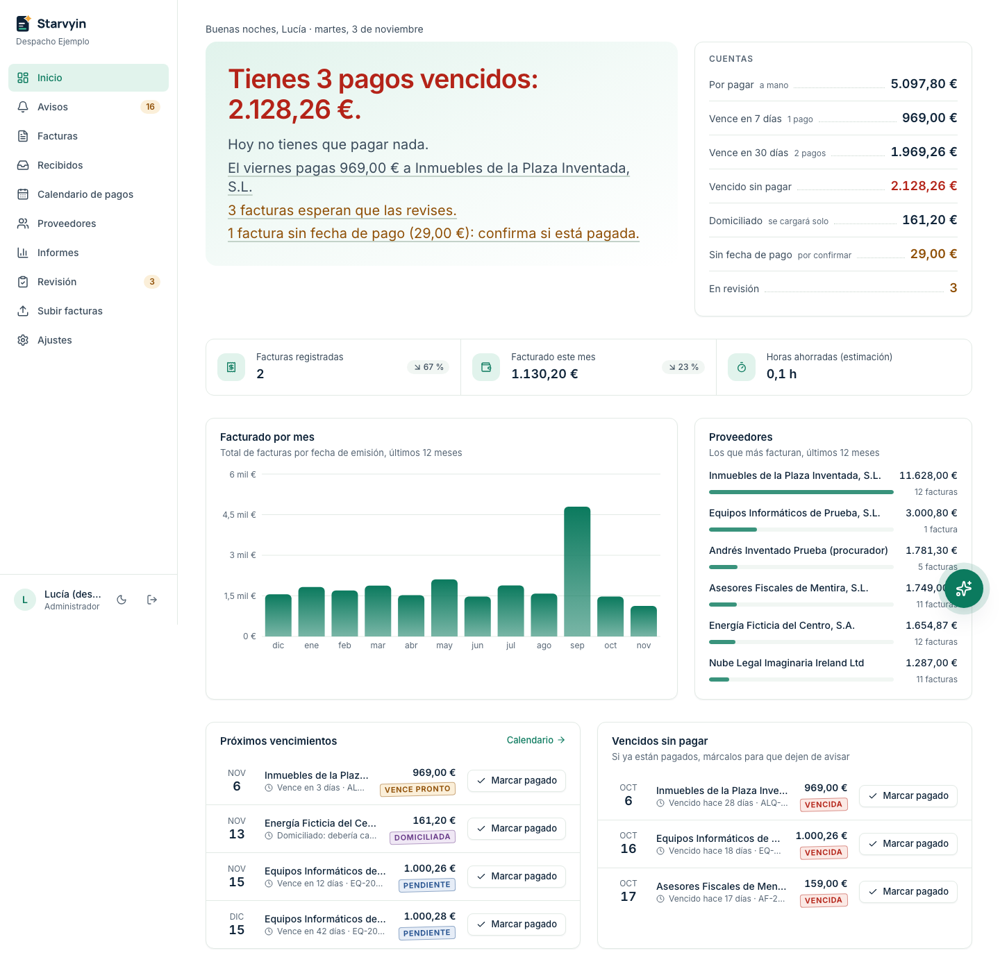
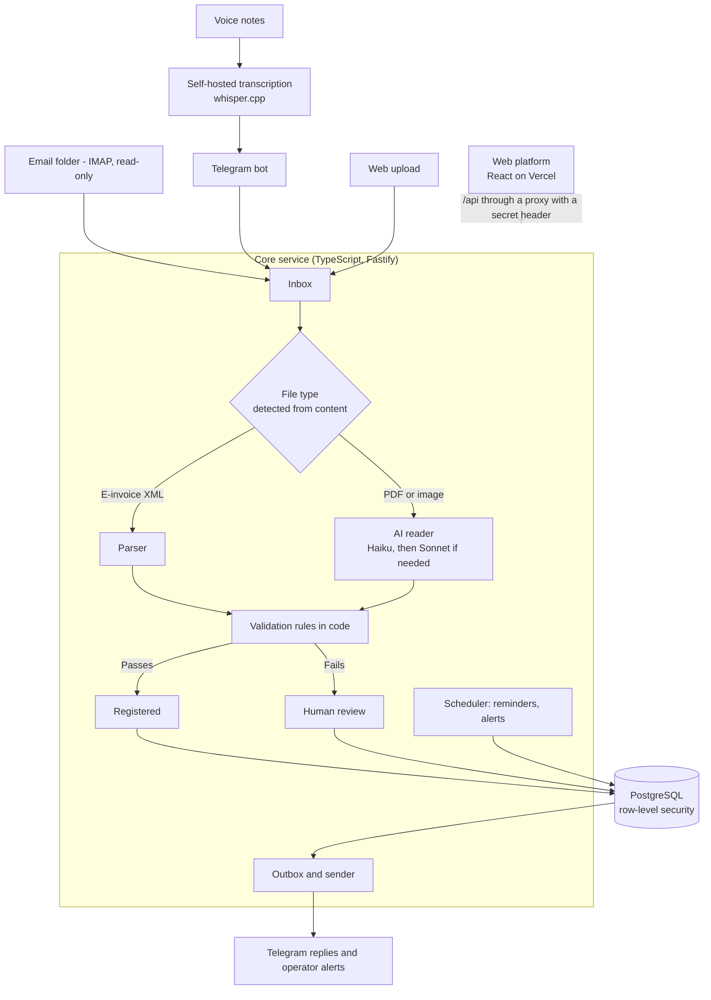
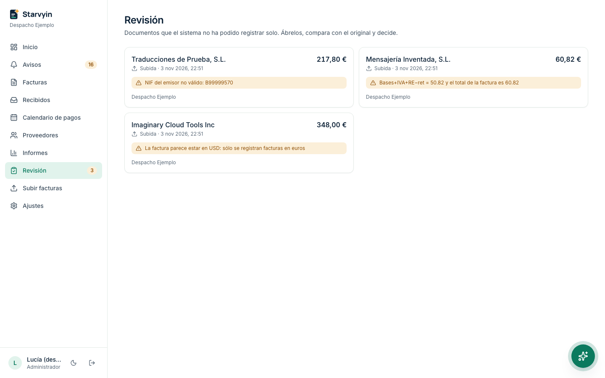

# Starvyin: AI Invoice Processing for Small Businesses

Starvyin receives supplier invoices by email, Telegram, or web upload, reads them with AI, checks every result with deterministic code, and manages them on a web platform with a payment calendar and reminders.

**The main design idea: the AI reads, but code does the math and makes the decisions.** A result that fails validation goes to a person for review. It is never saved as if it were correct.

> **What is in this repository:** a showcase of the commercial product. It includes the validation engine, its tests, and a runnable demo. The rest of the system (web platform, API, database schema, AI prompts, and assistant) is proprietary and stays in a private repository. I can walk through it in an interview.



*All screenshots use fictional data. The interface is in Spanish because the product is built for businesses in Spain.*

## 1. Project Overview

Starvyin is a multi-tenant web application for small businesses and for accounting firms that manage several companies. It turns invoices in PDF, photo, scan, or e-invoice XML format into validated records, then shows the business what it owes, when each payment is due, and which documents need attention.

I designed and built the system as a solo developer, using AI-assisted development with Claude Code.

## 2. Business Problem

Small businesses receive supplier invoices in many formats and through many channels. Entering them by hand takes time, and mistakes affect real money: a wrong total gets paid, a due date gets missed, or a duplicate gets recorded twice.

AI can read invoices quickly, but it creates a new risk. A model can return a wrong number that looks completely correct. If nothing checks the output, those errors reach the business records silently. The system has to be fast **and** make its mistakes visible.

## 3. Solution

- **Three ways in:** a dedicated email folder (read-only), a Telegram bot, or upload on the platform.
- **AI extraction with evidence:** the model returns a fixed structure and quotes the text behind each field. It has no tools and cannot write to the database.
- **Validation by code:** code adds up the totals, checks tax IDs and dates, confirms that values appear in the document, and detects duplicates.
- **Human review:** anything that fails goes to a review queue with a clear reason, next to the original document.
- **Daily operations:** dashboards, a payment calendar, reminders, reports, and an AI assistant that answers questions using verified data.

## 4. Technologies Used

| Area | Technologies |
|---|---|
| Language and backend | TypeScript (Node.js 22+), Fastify, Zod |
| AI | Anthropic API: Claude Haiku 5.5 as the main reader, Claude Sonnet 5.5 as the second attempt |
| Voice | whisper.cpp and ffmpeg, self-hosted so audio does not go to a third party |
| Database | PostgreSQL 17 with row-level security and hand-written SQL migrations |
| Frontend | React, Vite, Tailwind CSS, TanStack Query, Recharts |
| Integrations | IMAP (ImapFlow), Telegram Bot API, Facturae XML (Spanish e-invoice format) |
| Testing | Vitest, Docker, GreenMail (test IMAP server), Playwright, axe (accessibility) |
| Infrastructure | Docker, EasyPanel (VPS), Vercel |

This table describes the whole product. The code in this repository uses TypeScript, Zod, and Vitest.

## 5. System Architecture



Only the web platform and its API proxy are exposed to the internet. Email and Telegram connections start from the server.

More detail: [engineering rules](docs/ENGINEERING_RULES.md) and [evaluation](docs/EVALUATION.md).

## 6. Key Features

**AI and automation**
- Two-model cascade: a low-cost model reads first, and a stronger model tries again only when the numbers do not add up or a required field is missing.
- Structured output with literal evidence for each field, plus cost, token, latency, and raw-response logging for every extraction.
- Evaluation scripts that compare model and prompt versions before a change is merged.
- An assistant on Telegram and on the platform. It uses a closed list of database queries, never SQL written by the AI. Code verifies every figure in a drafted answer, and no action runs without a "yes" to a specific question.

**Reliability**
- Every document ends in a visible state: registered, in review, duplicate, not an invoice, or extraction error with retries.
- Duplicates are detected by supplier tax ID, invoice number, and fiscal year, so the same invoice scanned twice is caught. Database unique indexes enforce this and are tested under concurrency.
- An outbox table means a message is only sent after the database transaction commits.
- Spending limits per document and per client per day, and alerts to the operator for technical failures.

**Security and privacy**
- Tenant isolation with forced PostgreSQL row-level security. A query without a client context fails instead of returning zero rows, and the application checks this isolation at startup.
- Only the document goes to the extraction model, never the email text, sender, or username.
- Documents have no public links. They are served through the core service after session and permission checks, using links that expire in minutes.
- Client differences live in strictly validated YAML files, so a misspelled key stops the application from starting.

**Business platform**
- Dashboard, payment calendar, invoice history, suppliers, reports, and reminders.
- Role-based access for administrators, users, and read-only viewers across several companies.
- Measurement of the time people actually spend reviewing documents, to calculate net hours saved.
- Mobile layouts checked at 320 px, including with WebKit.



## 7. How It Works

1. An invoice arrives by email, Telegram, or upload.
2. The system saves it and identifies the file type from its content, not its name.
3. E-invoice XML goes to a parser. PDFs and images go to the AI model, which copies the data without calculating anything.
4. Code checks the result: do the totals add up, is the tax ID valid, are the dates reasonable, do the values appear in the document, has this invoice been seen before?
5. If an extraction check fails, a second model tries. If it still fails, or a business rule fails, a person reviews it.
6. Valid invoices are registered, and their payments appear on the calendar with reminders.
7. Every human correction is logged with the field, old value, new value, author, and time.


## 8. Setup Instructions

The demo runs the real validation rules on fictional model outputs. **It needs no API keys, no database, and no access to private systems.**

**Requirement:** Node.js 22+.

```bash
npm ci
npm run demo       # shows what the rules decide for 5 fictional invoices
npm run typecheck
npm test
```

Example output:

```text
Total misread by the model
  -> segundo_intento
     [bloquea] cuadre: bases+IVA+RE−ret = 117.12 y el total de la factura es 171.12; ...

Due date before the issue date (advance payment)
  -> registrar
     [aviso] vencimiento_anterior: hay un vencimiento anterior a la fecha de emisión
```

`segundo_intento` means a second model tries the invoice, `revision` sends it to a person, and `registrar` records it. `bloquea` is a blocking problem and `aviso` is a warning.

## 9. Results

**In use:** an earlier version of this automation, which I built on n8n, has been running at a pharmacy in Madrid for more than 8 months. It handles the pharmacy's invoice processing and helps the business keep its invoices under control. Starvyin is the code-based product I built afterward from that experience.

**Measured on fictional data only** (details and limits in [docs/EVALUATION.md](docs/EVALUATION.md)):

| Measure | Result |
|---|---|
| Automated tests, full product (private repository) | 1,209 passing, including isolation tests against a real database |
| Automated tests in this repository | 292 passing |
| Extraction, first reader only (37 fictional invoices, one read each) | 565 of 568 fields correct |
| Extraction cost, first reader | About $0.0013 per invoice |
| Assistant intent recognition (124 fictional messages, 2 rounds) | 248 of 248 correct |
| Assistant drafted answers passing the code verifier | 87 of 88; the other answer fell back to a code-written reply |

Fictional invoices are not a substitute for real-world accuracy, and these numbers should not be read as a production error rate.

## Repository Guide

The product serves Spanish businesses, so domain names and code comments are in Spanish.

| Path | Contents |
|---|---|
| `src/validacion/reglas.ts` | The validation rules and the decision on each invoice |
| `src/core/` | Tax ID and IBAN checks, dates, document and payment state machines |
| `src/extraccion/` | Model output schema, evidence checks, Facturae XML parser |
| `tests/` | Tests for each rule, with cases that pass and cases that block |
| `pruebas/` | Fictional invoices used by the tests |
| `scripts/demo.ts` | The runnable demo |

| Spanish term | English |
|---|---|
| factura | invoice |
| proveedor | supplier |
| vencimiento | due date |
| revisión | human review |
| NIF | Spanish tax ID |
| regla | rule |

## Copyright

© Jaime Casado Esteban. All rights reserved. The code is shared for portfolio review only. No license to use, copy, modify, or distribute it is granted.
